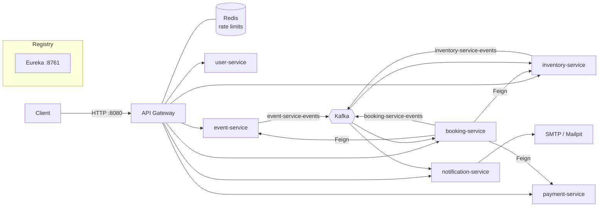

# Event Booking Backend

A microservices backend for publishing events and booking tickets, built with Spring Boot 4, Spring Cloud and Java 21. Services find each other through Eureka, sit behind a rate-limited API gateway, and share state changes over Kafka.

## Features

- **JWT authentication** with access and refresh tokens, and role-based access (`CUSTOMER`, `ORGANIZER`, `ADMIN`)
- **Event catalogue**: events, venues, categories and ticket types, with a draft → publish workflow for organizers
- **Seat inventory with time-limited holds**: tickets are held during checkout and released automatically when a hold expires
- **Bookings with compensation**: if payment fails, the hold is released; if a later step fails, the payment is refunded
- **Pluggable payments** (card, UPI, wallet) using the strategy pattern. All payment methods are simulated.
- **Notifications** in-app and by email, triggered by booking events
- **Per-route rate limiting** at the gateway, backed by Redis
- **Runs with Docker Compose**: one command starts the whole stack

## Architecture



Each service has its own PostgreSQL database (`user_db`, `event_db`, `inventory_db`, `payment_db`, `booking_db`, `notification_db`), all on one Postgres instance. Services register with Eureka, and the gateway routes to them with `lb://` URIs.

### Services

| Service | Port | Responsibility |
|---|---|---|
| `service-registry` | 8761 | Eureka server |
| `api-gateway` | 8080 | Single entry point, routing, JWT pass-through, Redis rate limiting |
| `user-service` | 8081 | Registration, login, token refresh, user and role management |
| `event-service` | 8082 | Events, venues, categories, ticket types |
| `inventory-service` | 8083 | Ticket stock per ticket type, holds (create / confirm / release / expire) |
| `payment-service` | 8084 | Simulated payment processing and refunds |
| `booking-service` | 8085 | Booking orchestration across event, inventory and payment |
| `notification-service` | 8086 | In-app notifications and email, from booking events |

### Kafka topics

| Topic | Producer | Consumers | Purpose |
|---|---|---|---|
| `event-service-events` | event-service | inventory-service | Creates inventory when a ticket type is created |
| `inventory-service-events` | inventory-service | booking-service | Hold held / confirmed / released (expired holds expire the booking) |
| `booking-service-events` | booking-service | notification-service | `BOOKING_CREATED`, `BOOKING_CONFIRMED`, `BOOKING_CANCELLED`, `BOOKING_EXPIRED`, `BOOKING_PAYMENT_FAILED` |

### Booking flow

1. `POST /api/v1/bookings`: booking-service checks that the ticket type exists and that the event is published, then places a hold in inventory-service. The booking is now `HELD`.
2. `POST /api/v1/bookings/{id}/confirm`: payment-service charges the booking, inventory-service confirms the hold, and the booking becomes `CONFIRMED`.
   - If the payment fails, the hold is released and the booking becomes `PAYMENT_FAILED`.
   - If confirming the hold fails after a successful charge, the payment is refunded.
3. If the hold expires before confirmation, the booking becomes `EXPIRED`.
4. `POST /api/v1/bookings/{id}/cancel` cancels the booking, refunding the payment if one was taken.

Booking statuses: `PENDING`, `HELD`, `CONFIRMED`, `CANCELLED`, `EXPIRED`, `PAYMENT_FAILED`.

## Tech stack

- Java 21, Spring Boot 4.1, Spring Cloud 2025.1
- Spring Cloud Gateway (WebFlux), Netflix Eureka, OpenFeign
- Spring Security with JJWT
- Spring Data JPA, PostgreSQL 16, Flyway (booking, payment, notification services)
- Apache Kafka (Confluent 7.6 with Zookeeper)
- Redis 7 (gateway rate limiting)
- springdoc-openapi (Swagger UI)
- Mailpit for local email
- Docker Compose
- Lombok, Maven (wrapper in each service)

## Getting started

### Prerequisites

- Docker Desktop (allow about 6 GB of memory: 8 JVMs plus Kafka and Postgres)
- Java 21 and Maven, only if you run services outside Docker

### 1. Configure environment

Create a `.env` file in the repository root. It is gitignored.

```env
POSTGRES_USER=postgres
POSTGRES_PASSWORD=<choose-a-password>

# Base64-encoded key of at least 256 bits, e.g. `openssl rand -base64 32`
JWT_SECRET=<your-secret>
JWT_ACCESS_EXPIRY_MS=900000       # 15 minutes
JWT_REFRESH_EXPIRY_MS=604800000   # 7 days
```

> `docker-compose.yml` has fallback values for these variables so the stack starts without a `.env`. The fallbacks are for local development only. Always set your own `POSTGRES_PASSWORD` and `JWT_SECRET`.

All services must use the same `JWT_SECRET`. Each service validates tokens itself.

Optional SMTP settings for notification-service (by default it sends to Mailpit):
`SPRING_MAIL_HOST`, `SPRING_MAIL_PORT`, `SPRING_MAIL_USERNAME`, `SPRING_MAIL_PASSWORD`, `SPRING_MAIL_SMTP_AUTH`, `SPRING_MAIL_SMTP_STARTTLS`, `NOTIFICATION_EMAIL_FROM`.

### 2. Run with Docker Compose

```bash
docker compose up -d --build
```

The first start takes a few minutes. Services may restart a few times while Kafka and Eureka come up.

| URL | What |
|---|---|
| http://localhost:8080/api/v1/... | API gateway (use this for all API calls) |
| http://localhost:8761 | Eureka dashboard |
| http://localhost:8025 | Mailpit inbox (emails sent by notification-service) |
| http://localhost:808x/swagger-ui.html | Swagger UI for each service (user, event, inventory, booking, notification) |

Stop everything:

```bash
docker compose down
```

To also delete the database volume, add `-v`.

### Running a single service locally

Start the infrastructure and the registry in Docker, then run the service from your IDE or with Maven:

```bash
docker compose up -d postgres-db redis zookeeper kafka mailpit service-registry
```

```bash
cd booking-service && ./mvnw spring-boot:run
```

From the host, Kafka is at `localhost:9094`. Point the service at local infrastructure with environment variables such as `SPRING_DATASOURCE_URL`, `SPRING_KAFKA_BOOTSTRAP_SERVERS` and `EUREKA_CLIENT_SERVICEURL_DEFAULTZONE`.

## API overview

All endpoints are under `/api/v1` and go through the gateway on port 8080. Apart from registration, login, token refresh and public catalogue reads, requests need an `Authorization: Bearer <access-token>` header. Swagger UI on each service documents request and response bodies.

| Area | Endpoints |
|---|---|
| Auth | `POST /auth/login`, `POST /auth/refresh` |
| Users | `POST /users` (register), `GET /users`, `GET /users/{id}`, `PATCH /users/{id}`, `DELETE /users/{id}`, `PATCH /users/{id}/role` (admin) |
| Events | `POST /events`, `GET /events`, `GET /events/{id}`, `PUT /events/{id}`, `DELETE /events/{id}`, `POST /events/{id}/publish`, `GET /events/manage`, `GET /events/manage/{id}` |
| Ticket types | `POST /events/{id}/ticket-types`, `GET /events/{id}/ticket-types`, `GET /events/{id}/ticket-types/manage`, `GET /ticket-types/{id}`, `PUT /ticket-types/{id}` |
| Venues / categories | `POST /venues`, `GET /venues`, `GET /venues/{id}`, `GET /categories` |
| Inventory | `POST /inventory`, `GET /inventory/{inventoryId}`, `GET /inventory/{eventId}/{ticketTypeId}` |
| Holds | `POST /inventory/{inventoryId}/hold`, `GET /holds/{holdId}`, `POST /holds/{holdId}/confirm`, `POST /holds/{holdId}/release` |
| Bookings | `POST /bookings`, `POST /bookings/{id}/confirm`, `POST /bookings/{id}/cancel`, `GET /bookings/{id}`, `GET /bookings/my`, `GET /bookings` (admin) |
| Payments | `POST /payments/process`, `GET /payments/{id}`, `GET /payments/booking/{bookingId}`, `POST /payments/{id}/refund`, `POST /payments/booking/{bookingId}/refund` |
| Notifications | `GET /notifications`, `GET /notifications/unread-count`, `PATCH /notifications/{id}/read`, `PATCH /notifications/read-all` |

### Example: book a ticket

```bash
# 1. Log in and copy the access token from the response
curl -X POST http://localhost:8080/api/v1/auth/login \
  -H "Content-Type: application/json" \
  -d '{"email":"user@example.com","password":"<password>"}'

# 2. Create a booking (places an inventory hold)
curl -X POST http://localhost:8080/api/v1/bookings \
  -H "Authorization: Bearer $TOKEN" -H "Content-Type: application/json" \
  -d '{"eventId":"<event-id>","ticketTypeId":"<ticket-type-id>","quantity":2,"idempotencyKey":"<uuid>"}'

# 3. Pay and confirm (paymentMethod: CARD, UPI or WALLET)
curl -X POST http://localhost:8080/api/v1/bookings/<booking-id>/confirm \
  -H "Authorization: Bearer $TOKEN" -H "Content-Type: application/json" \
  -d '{"paymentMethod":"CARD","idempotencyKey":"<uuid>"}'
```

`idempotencyKey` is a client-generated UUID. Send the same key when retrying a request so it is not processed twice. Swagger UI documents all request fields.

**Testing failures:** a card payment of exactly `13.00` is always declined. Use it to exercise the payment-failure and hold-release path.

### Rate limits (per gateway route)

| Route | Key | Replenish / burst (requests per second) |
|---|---|---|
| users, auth | client IP | 1 / 5 |
| events, venues, categories, ticket types | client IP | 20 / 40 |
| inventory, holds | user | 5 / 10 |
| payments | user | 2 / 5 |
| bookings | user | 2 / 5 |
| notifications | user | 5 / 10 |

When a limit is exceeded, the gateway returns `429 Too Many Requests`.

## Project structure

```
event-booking-backend/
├── api-gateway/            # Spring Cloud Gateway
├── service-registry/       # Eureka server
├── user-service/
├── event-service/
├── inventory-service/
├── payment-service/
├── booking-service/
├── notification-service/
├── docker/init-db.sql      # creates one database per service
└── docker-compose.yml
```

Each service is an independent Maven project with its own `pom.xml`, Maven wrapper and `Dockerfile`.

## Running tests

```bash
cd <service-name> && ./mvnw test
```

## Limitations

- Payments are simulated. No real payment provider is integrated.
- Kafka and Zookeeper data is not persisted, so topics are lost when their containers restart.
- Eureka is a single instance, and the Compose setup is meant for local development.
